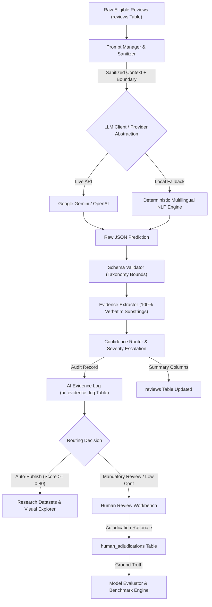

# AI Classification & Enrichment Architecture
**Groww AI-Powered Investor Discovery Engine • Phase 4**  
**Document Version:** 1.0.0  
**Last Updated:** 2026-11-06  

---

## 1. Architectural Overview

The Phase 4 AI enrichment system transforms raw, multilingual customer feedback into structured, reproducible, and verifiable research intelligence.

---

## 2. Component Specifications

### A. Prompt Manager & Security Sanitizer (`ai/prompt_manager.py`)
- **Untrusted Input Boundary:** Enforces `<REVIEW_DATA>` tags to separate instructions from data.
- **Escape Sanitization:** Converts `</REVIEW_DATA>` to `[/REVIEW_DATA]` and disables markdown execution syntax.
- **Reproducibility Hashing:** Computes SHA-256 hashes of rendered prompt templates, stored in `prompt_hash` for complete auditability.

### B. LLM Client & Provider Abstraction (`ai/llm_client.py`)
- **Provider Agnostic:** Configured via `config/model_config.yml`.
- **Live Providers:** Supports Google Gemini API (`gemini-1.5-flash`), OpenAI API (`gpt-4o-mini`), and local Ollama (`llama3.2`).
- **Deterministic Offline Engine:** Fallback engine `rule-nlp-v2.0` enables full execution, testing, and continuous integration without external API keys or rate-limit failures.

### C. Schema Validator (`ai/schema_validator.py`)
- **JSON Schema Conformance:** Validates 14 required structural keys.
- **Taxonomy Normalization:** Maps lifecycle aliases (e.g., `S2_FIRST_PAYMENT` $\rightarrow$ `S2_EARLY`) and verifies labels against `config/review_taxonomy.yml`.
- **Confidence Bounding:** Enforces confidence scores $0.0 \le c \le 1.0$.

### D. Exact Evidence Extractor (`ai/evidence_extractor.py`)
- **Verbatim Grounding Invariant:** Verifies that candidate quotes exist as exact character-for-character substrings in the original review text.
- **Punctuation Trimming:** Cleans bounding quotes and brackets while recovering original casing and character offsets `[start, end]`.
- **Status Classification:** Assigns `FULLY_GROUNDED`, `PARTIALLY_GROUNDED`, `UNSUPPORTED`, or `NO_EVIDENCE_STATED`.

### E. Confidence Router (`ai/confidence.py`)
- **Thresholds:**
  - $\text{Score} < 0.65$: Low confidence $\rightarrow$ `MANDATORY_REVIEW`.
  - $0.65 \le \text{Score} < 0.80$: Medium confidence $\rightarrow$ `SAMPLE_AUDIT`.
  - $\text{Score} \ge 0.80$: High confidence $\rightarrow$ `AUTO_PUBLISH`.
- **Safety Overrides:** High-severity pain points (mandate failure, money deducted not reflected, double debit, pause/cancel difficulties) automatically escalate to `MANDATORY_REVIEW` regardless of confidence.

### F. Human Review Workbench (`services/human_review_service.py`)
- Interactive Streamlit screen enabling expert researchers to inspect source text, evaluate predicted labels, accept, correct, or reject classifications, and record rationale.
- Inter-annotator agreement tracking using Cohen's Kappa ($\kappa$).

---

## 3. Database Schema Integration

The SQLite schema incorporates three primary entities:

1. **`reviews`**: Foundational repository containing raw text, canonical metadata, and AI enrichment summaries (`ai_lifecycle_stage`, `ai_primary_pain_point`, `ai_confidence_score`, `ai_confidence_tier`).
2. **`ai_evidence_log`**: Detailed audit trail storing model provenance, prompt hashes, JSON label sets, confidence breakdowns, and exact verbatim spans.
3. **`human_adjudications`**: Ground-truth validation records logging adjudicator ID, original vs corrected labels, rationale, and timestamps.
