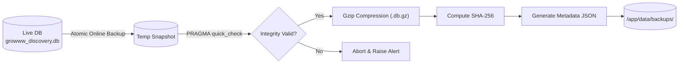

# GROWWW INVESTOR DISCOVERY ENGINE – BACKUP & DISASTER RECOVERY RUNBOOK
**Document Version:** 1.0  
**Phase:** 8 Production Operations  
**Verified RPO (Recovery Point Objective):** 24 hours (weekly scheduled or nightly cron)  
**Verified RTO (Recovery Time Objective):** < 3 minutes  

---

## 1. BACKUP ARCHITECTURE & DESIGN

The Growww Discovery Engine utilizes an atomic, non-blocking backup mechanism backed by SQLite's online backup API (`sqlite3.backup`).



### Key Architectural Characteristics
- **Zero Lock Contention:** The live database continues serving read queries and user traffic while the snapshot is copied.
- **Pre-Compression Verification:** The snapshot must pass `PRAGMA quick_check;` before compression.
- **Cryptographic Grounding:** Every backup archive is paired with an SHA-256 checksum stored in `.meta.json`.
- **Space Efficiency:** The 8.2 MB SQLite database compresses down to ~1.48 MB (82% space reduction).

---

## 2. BACKUP RETENTION POLICY

The automated retention manager (`enforce_retention_policy`) prunes obsolete archives to prevent persistent disk exhaustion:
- **Daily Backups:** Retained for 7 days.
- **Weekly Backups:** Retained for 4 weeks.
- **Monthly Backups:** Retained for 12 months.
- **Default Maximum Archives in Directory:** 28 backups.

---

## 3. EXECUTING A BACKUP

To trigger an immediate backup:

```bash
PYTHONPATH=.:./lib python3 scripts/backup_database.py \
    --source-db growww_discovery.db \
    --backup-dir data/backups \
    --retention 28
```

### Sample Output:
```
[*] Starting backup of: /app/growww_discovery.db
[+] BACKUP COMPLETED & VERIFIED SUCCESSFULLY!
    File:      growww_backup_20261107_164727.db.gz (1483217 bytes)
    SHA-256:   65fec873f48e74b55165bdcbcb4ee6e574dca88f4c50a29fdb0c13c9893ec64c
    Reviews:   3798 total (3790 eligible, 8 quarantined)
    AI Ev:     1532
    Opps:      7
```

---

## 4. RESTORING FROM BACKUP

The restoration script `scripts/restore_database.py` validates archive checksums, decompresses the database, and executes a rigorous 4-stage integrity audit:

```bash
PYTHONPATH=.:./lib python3 scripts/restore_database.py \
    --backup-file data/backups/growww_backup_20261107_164727.db.gz \
    --target-db growww_discovery.db
```

### 4-Stage Post-Restore Audit:
1. **Cryptographic Verification:** Matches archive SHA-256 against recorded manifest.
2. **SQLite Integrity Check:** Executes `PRAGMA quick_check;`. Must return `ok`.
3. **Foreign Key Integrity:** Executes `PRAGMA foreign_key_check;`. Must return 0 violations.
4. **Row Count & Verbatim Grounding Reconciliation:**
   - Total Reviews: $\ge 3,798$
   - Eligible Reviews: $\ge 3,790$
   - Synthetic Quarantined: Exactly $8$
   - AI Evidence Records: $\ge 1,530$
   - Opportunity Grounding: $7/7$ opportunities match actual verbatim customer quotes.

---

## 5. DISASTER RECOVERY PROCEDURES

### Scenario 1: Database File Corruption or Accidental Deletion
1. Stop the Streamlit application container:
   ```bash
   docker-compose stop growww-engine
   ```
2. Locate the most recent verified backup in `data/backups/`:
   ```bash
   LATEST_BACKUP=$(ls -t data/backups/*.db.gz | head -n 1)
   ```
3. Restore into the live database location:
   ```bash
   PYTHONPATH=.:./lib python3 scripts/restore_database.py \
       --backup-file "$LATEST_BACKUP" \
       --target-db growww_discovery.db
   ```
4. Restart application container:
   ```bash
   docker-compose start growww-engine
   ```
5. Confirm operational status:
   ```bash
   PYTHONPATH=.:./lib python3 scripts/health_check.py
   ```

### Scenario 2: Data Contamination Incident
If bad data was ingested or synthetic records leaked into research queries:
1. Immediately switch off public traffic or pause scheduler:
   ```bash
   docker-compose stop growww-engine
   ```
2. Restore from the pre-incident backup archive.
3. Validate quarantine isolation using `scripts/health_check.py`.
4. Rerun analytical aggregations and restart web service.
