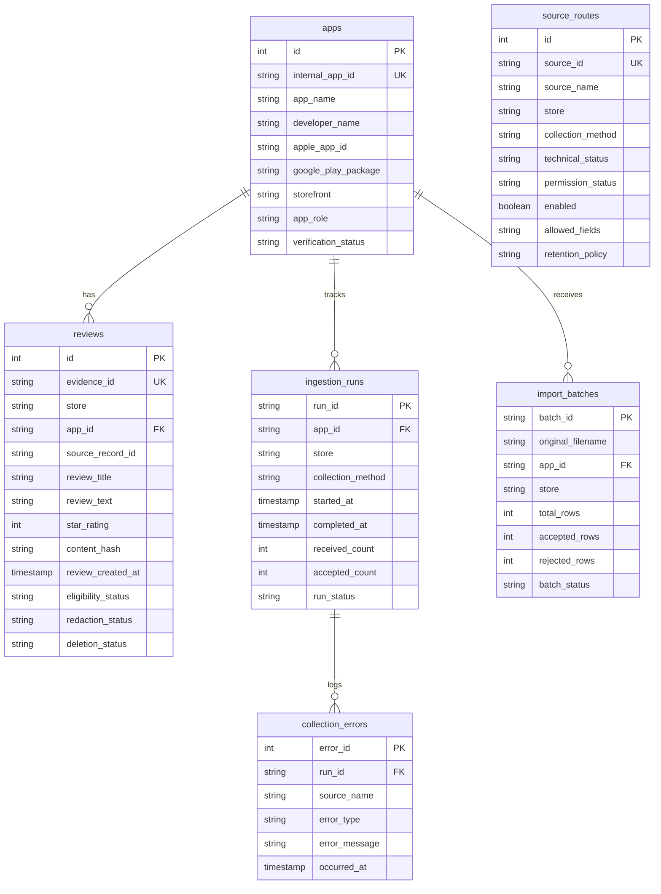

# Growww Discovery Engine: Database Schema Specification
## Canonical Schema Architecture & Entity Relationship Reference
**Phase 1 Deliverable | Repository & Application Foundation**  
**Database Engine:** SQLite 3 (Portable to PostgreSQL / Supabase)  
**Schema Version:** 1.0.0  

---

## 1. Entity-Relationship Overview

---

## 2. Table Specifications

### 2.1 Table: `apps`
Maintains verified candidate investment applications and competitor profiles.

| Column | Type | Constraints | Description |
|---|---|---|---|
| `id` | INTEGER | PRIMARY KEY AUTOINCREMENT | Internal synthetic sequence ID |
| `internal_app_id` | TEXT | UNIQUE NOT NULL | Slug identifier (`groww`, `zerodha_coin`, etc.) |
| `app_name` | TEXT | NOT NULL | Official application display title |
| `developer_name` | TEXT | NOT NULL | Legal publisher / corporate entity name |
| `apple_app_id` | TEXT | NULLABLE | Numeric Apple App Store ID |
| `google_play_package`| TEXT | NULLABLE | Reverse-domain Android package name |
| `apple_listing_url` | TEXT | NULLABLE | Direct web URL to Apple store page |
| `google_play_listing_url`| TEXT | NULLABLE | Direct web URL to Google Play page |
| `storefront` | TEXT | NOT NULL DEFAULT 'IN'| Storefront region code |
| `app_role` | TEXT | NOT NULL | `primary_case_study` or competitor archetype |
| `verification_status`| TEXT | NOT NULL | `VERIFIED`, `UNVERIFIED` |
| `created_at` | TIMESTAMP | DEFAULT CURRENT_TIMESTAMP | Record creation timestamp |
| `updated_at` | TIMESTAMP | DEFAULT CURRENT_TIMESTAMP | Last synchronization timestamp |

---

### 2.2 Table: `source_routes`
Maintains data governance permissions, compliance policies, and connector activation states.

| Column | Type | Constraints | Description |
|---|---|---|---|
| `id` | INTEGER | PRIMARY KEY AUTOINCREMENT | Sequence ID |
| `source_id` | TEXT | UNIQUE NOT NULL | Source identifier (`apple_app_store_public_rss`, etc.) |
| `source_name` | TEXT | NOT NULL | Human-readable route name |
| `store` | TEXT | NOT NULL | Origin store (`apple_app_store`, `google_play`) |
| `collection_method`| TEXT | NOT NULL | `public_syndication_rss`, `manual_csv_import`, etc. |
| `technical_status` | TEXT | NOT NULL | `AVAILABLE`, `PARTIALLY_AVAILABLE`, `UNAVAILABLE` |
| `permission_status`| TEXT | NOT NULL | `APPROVED`, `PENDING_VERIFICATION`, `REJECTED` |
| `enabled` | BOOLEAN | NOT NULL DEFAULT 0 | Strict governance flag; 0 = disabled |
| `allowed_fields` | TEXT | NULLABLE | Comma-separated list of permitted fields |
| `retention_policy` | TEXT | NULLABLE | Data minimization / retention guideline reference |
| `last_verified_at` | TIMESTAMP | NULLABLE | Last audit timestamp |

---

### 2.3 Table: `reviews`
Canonical storage for customer reviews across all platforms.

| Column | Type | Constraints | Description |
|---|---|---|---|
| `id` | INTEGER | PRIMARY KEY AUTOINCREMENT | Surrogate key |
| `evidence_id` | TEXT | UNIQUE NOT NULL | Cryptographic evidence handle |
| `store` | TEXT | NOT NULL | `apple_app_store` or `google_play` |
| `app_id` | TEXT | NOT NULL, FK -> apps | Target app foreign key |
| `source_record_id` | TEXT | NULLABLE | Origin review ID from platform |
| `canonical_url` | TEXT | NULLABLE | Provenance web link |
| `collection_run_id` | TEXT | NULLABLE | Ingestion batch or run reference |
| `collection_method` | TEXT | NOT NULL | `manual_csv_import`, `apple_rss` |
| `source_permission_id`| TEXT | NULLABLE | Legal permission reference |
| `review_title` | TEXT | NULLABLE | Headline / title of review |
| `review_text` | TEXT | NOT NULL | Verbatim text (PII scrubbed) |
| `language_original` | TEXT | DEFAULT 'unknown' | Original script / language code |
| `language_detected` | TEXT | NULLABLE | Detected language code |
| `translated_text` | TEXT | NULLABLE | English normalized translation |
| `content_hash` | TEXT | NOT NULL | SHA-256 fingerprint for deduplication |
| `content_status` | TEXT | DEFAULT 'ORIGINAL' | `ORIGINAL`, `REDACTED` |
| `redaction_status` | TEXT | DEFAULT 'CLEAN' | `CLEAN`, `REDACTED` |
| `storefront` | TEXT | DEFAULT 'IN' | Store region code |
| `app_version` | TEXT | NULLABLE | App version string at review time |
| `star_rating` | INTEGER | NOT NULL, CHECK(1-5) | Star rating integer |
| `review_created_at` | TIMESTAMP | NOT NULL | UTC submission timestamp |
| `review_updated_at` | TIMESTAMP | NULLABLE | Last updated timestamp |
| `retrieved_at` | TIMESTAMP | DEFAULT CURRENT_TIMESTAMP | Ingestion timestamp |
| `provider_name` | TEXT | NULLABLE | Data provider label |
| `store_listing_url` | TEXT | NULLABLE | App listing link |
| `eligibility_status`| TEXT | NOT NULL DEFAULT 'PENDING'| `ELIGIBLE`, `PENDING`, `SYNTHETIC_DEMO`, `REJECTED` |
| `source_policy_version`| TEXT | DEFAULT '1.0.0' | Policy version |
| `retention_expiry_at`| TIMESTAMP | NULLABLE | Scheduled purge timestamp |
| `deletion_status` | TEXT | DEFAULT 'ACTIVE' | `ACTIVE`, `PURGED` |
| `created_at` | TIMESTAMP | DEFAULT CURRENT_TIMESTAMP | Database insert timestamp |

**Table Constraints & Indexes:**
- `CONSTRAINT uq_app_store_source_record UNIQUE (app_id, store, source_record_id)`
- Indexes: `idx_reviews_app_store`, `idx_reviews_eligibility`, `idx_reviews_rating`, `idx_reviews_created_at`, `idx_reviews_content_hash`.

---

### 2.4 Table: `ingestion_runs`
Audit ledger of automated and scheduled connector runs.

| Column | Type | Constraints | Description |
|---|---|---|---|
| `run_id` | TEXT | PRIMARY KEY | Unique UUID or run identifier |
| `app_id` | TEXT | NOT NULL | Target app internal ID |
| `store` | TEXT | NOT NULL | Platform store |
| `collection_method` | TEXT | NOT NULL | Connector type |
| `started_at` | TIMESTAMP | NOT NULL | Run start timestamp |
| `completed_at` | TIMESTAMP | NULLABLE | Run finish timestamp |
| `requested_count` | INTEGER | DEFAULT 0 | Records requested |
| `received_count` | INTEGER | DEFAULT 0 | Records returned |
| `accepted_count` | INTEGER | DEFAULT 0 | New records accepted |
| `rejected_count` | INTEGER | DEFAULT 0 | Records rejected |
| `duplicate_count` | INTEGER | DEFAULT 0 | Duplicate records skipped |
| `run_status` | TEXT | NOT NULL | `STARTED`, `COMPLETED`, `FAILED` |
| `coverage_start` | TIMESTAMP | NULLABLE | Oldest review date in batch |
| `coverage_end` | TIMESTAMP | NULLABLE | Newest review date in batch |
| `error_summary` | TEXT | NULLABLE | Diagnostics summary |

---

### 2.5 Table: `collection_errors`
Diagnostics failure logs for connector troubleshooting.

| Column | Type | Constraints | Description |
|---|---|---|---|
| `error_id` | INTEGER | PRIMARY KEY AUTOINCREMENT | Error log sequence |
| `run_id` | TEXT | NULLABLE | Associated run ID |
| `source_name` | TEXT | NOT NULL | Connector / route name |
| `error_type` | TEXT | NOT NULL | Exception or error class |
| `error_message` | TEXT | NOT NULL | Detailed error text |
| `occurred_at` | TIMESTAMP | DEFAULT CURRENT_TIMESTAMP | Timestamp |
| `retry_count` | INTEGER | DEFAULT 0 | Number of retries attempted |
| `resolution_status` | TEXT | DEFAULT 'UNRESOLVED' | `UNRESOLVED`, `RESOLVED`, `IGNORED` |

---

### 2.6 Table: `import_batches`
Metadata tracking for manual CSV file ingestion sessions.

| Column | Type | Constraints | Description |
|---|---|---|---|
| `batch_id` | TEXT | PRIMARY KEY | Batch UUID string |
| `original_filename` | TEXT | NOT NULL | Name of uploaded CSV file |
| `uploaded_at` | TIMESTAMP | DEFAULT CURRENT_TIMESTAMP | Upload timestamp |
| `app_id` | TEXT | NOT NULL | Associated application |
| `store` | TEXT | NOT NULL | Associated store |
| `source_description`| TEXT | NULLABLE | User-provided provenance narrative |
| `permission_status` | TEXT | NOT NULL | Source permission state |
| `total_rows` | INTEGER | DEFAULT 0 | Total rows in file |
| `accepted_rows` | INTEGER | DEFAULT 0 | Rows persisted |
| `rejected_rows` | INTEGER | DEFAULT 0 | Rows failing validation |
| `duplicate_rows` | INTEGER | DEFAULT 0 | Duplicate rows skipped |
| `batch_status` | TEXT | NOT NULL | `PROCESSING`, `COMPLETED`, `FAILED` |
