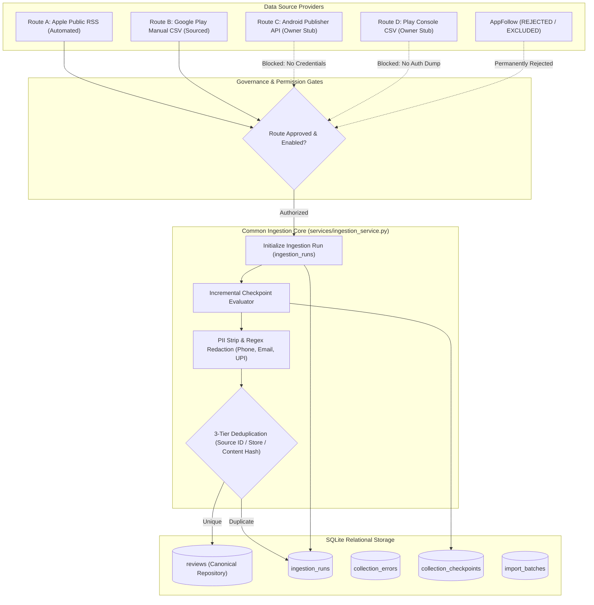

# Unified Ingestion Pipeline Architecture (Phase 2 MVP)
**Module:** `services/ingestion_service.py`  
**Database Schema:** Version 1.2.0 (`growww_discovery.db`)  
**Scope:** Two-Store Review Collection Engine  

---

## 1. Architectural Overview

The Phase 2 ingestion subsystem establishes a robust, governance-controlled, and idempotent ingestion framework supporting two active stores (Apple App Store & Google Play Store) while maintaining clean stubs for future owner-authorized routes.

---

## 2. Ingestion Routes Comparison

| Dimension | Route A: Apple Public RSS | Route B: Google Play Manual CSV | Route C: Publisher API | Route D: Console CSV |
| :--- | :--- | :--- | :--- | :--- |
| **Automation** | Fully automated | User-uploaded CSV | Automated REST | Manual console dump |
| **Storefront** | Apple App Store (`IN`) | Google Play Store (`IN`) | Google Play Store | Google Play Store |
| **Scope** | All 8 registered apps | Competitors & Groww | Groww owner only | Groww owner only |
| **Capacity** | 500 reviews / run | Unlimited | Quota-based | Unlimited |
| **Credentials** | None (Public RSS) | None (Public archives) | Service Account JSON | Play Console Login |
| **Permission** | `APPROVED` | `APPROVED` | `UNAVAILABLE` | `UNAVAILABLE` |
| **Phase Status** | **ACTIVE (Phase 2)** | **ACTIVE (Phase 2)** | FUTURE STUB | FUTURE STUB |

---

## 3. Deduplication Invariants

Idempotent ingestion is enforced via a strict 3-tier hierarchy in `ingestion/deduplicate.py`:

1. **Tier 1 (Source Record ID):** If `source_record_id` matches an existing record for the same application and platform, the record is immediately flagged as duplicate.
2. **Tier 2 (Composite Tuple):** `(store, app_id, source_record_id)` composite index prevents cross-store collision.
3. **Tier 3 (Canonical Normalized Content Hash):** When `source_record_id` is missing or generated, review text is normalized (whitespace collapsed, lowercased, punctuation preserved) and hashed via SHA-256. If `content_hash` already exists for that app and store, the record is flagged as duplicate.

---

## 4. Run Tracking & Failure Recovery

Every collection attempt is transacted through `IngestionRunLogger`:
- **Run Tracking:** Generates a unique `RUN_{APP}_{STORE}_{HEX8}` session ID in `ingestion_runs`.
- **Atomic Persistence:** Reviews are committed in a single database transaction context. If an unrecoverable failure occurs, partial writes are safely rolled back.
- **Error Auditing:** Operational errors (HTTP 429, timeouts, malformed XML/JSON, rejected rows) are logged to `collection_errors` with stack trace summaries.
- **Automatic CSV Synchronization:** Completed run metrics and collection errors are automatically mirrored to `outputs/ingestion_runs.csv` and `outputs/collection_errors.csv`.
