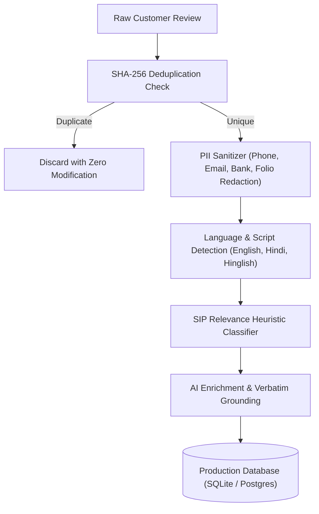

# GROWWW INVESTOR DISCOVERY ENGINE – RESEARCH METHODOLOGY GUIDE
**Document Version:** 1.0  
**Phase:** 8 – Final Handover & Methodology Documentation  
**Research Focus:** Systematic Discovery of SIP Friction in Indian Investment Applications  

---

## 1. RESEARCH OBJECTIVE & CASE STUDY DESIGN

The Growww Investor Discovery Engine investigates the lived experiences, friction points, behavioral patterns, and unfulfilled expectations of Indian retail mutual fund investors participating in Systematic Investment Plans (SIPs).

- **Primary Case Study:** Groww (India's leading retail mutual fund and investment platform).
- **Comparative Peer Group:** Zerodha Coin, Upstox, Angel One, Paytm Money.
- **Corpus Size:** 3,798 customer reviews analyzed (3,790 eligible research records, 8 quarantined demo records).
- **Core Research Target:** Identifying friction points that cause investors to abandon, pause, or churn from their SIP journeys, and translating those friction points into testable, high-impact product opportunities.

---

## 2. SAMPLING & PERMITTED SOURCE STRATEGY

### Permitted Data Channels
1. **Apple App Store Public Customer Review RSS:** Automated retrieval of public reviews submitted to the Apple App Store (India Storefront) via official RSS endpoints (`itunes.apple.com/in/rss/customerreviews`).
2. **Google Play Store Sourced CSV Imports:** Structured CSV imports of Android customer reviews collected through authorized routes and verified against strict schema constraints.

### Prohibited Sources
- **AppFollow / Paid Aggregators:** Permanently excluded under project mandate.
- **HTML Web Scraping:** Strictly forbidden to prevent legal, intellectual property, and rate-limiting issues.

---

## 3. DATA QUALITY, PRIVACY & ANONYMIZATION PIPELINE

Every customer review ingested by the engine undergoes a multi-stage standardization and anonymization process:

### Author Anonymity & Retention Rules
- **Author Identity:** Author usernames and internal app user identifiers are permanently stripped.
- **Demographic Inferences:** In accordance with research ethics, demographic attributes (gender, age, location) are never inferred from review text or names and default strictly to `UNKNOWN`.
- **Quarantine Isolation:** Demonstration records created during foundation testing are tagged `eligibility_status = 'SYNTHETIC_DEMO'` and excluded from all research analytics.

---

## 4. SIP RELEVANCE HEURISTIC CLASSIFICATION

A customer review is identified as SIP-relevant if it contains direct references to recurring mutual fund investment mechanisms:

- **Key Relevance Indicators:**
  - `mentions_sip`: Keywords matching `sip`, `systematic investment`, `recurring`.
  - `mentions_mandate`: Keywords matching `mandate`, `nach`, `enach`, `autopay`, `auto debit`.
  - `mentions_instalment`: Keywords matching `installment`, `deduction`, `cycle`, `due date`.
  - `mentions_nav`: Keywords matching `nav`, `folio`, `allotment`, `units allocated`.
  - `mentions_pause_stop`: Keywords matching `pause sip`, `stop sip`, `cancel sip`, `modify sip`.
- **Corpus Denominators:**
  - Total Eligible Research Reviews: **3,790**
  - Total SIP-Relevant Reviews: **158** (156 direct + 2 indirect)
  - SIP Prevalence in Retail Reviews: **4.17%**

---

## 5. AI ENRICHMENT & 100% VERBATIM GROUNDING

The enrichment subsystem classifies each review across two analytical dimensions:

### Dimension 1: Pain-Point Taxonomy (6 Categories)
1. **Mandate Registration & Bank Authorization Failures:** Difficulties setting up eNACH, net banking rejection, recurring OTP issues.
2. **NAV Allocation & Unit Allotment Delays:** Money deducted from bank account but units not allocated within T+2 settlement windows.
3. **Opaque SIP Modification & Pause Difficulties:** Lack of self-service options to alter installment dates, reduce amounts, or pause deductions.
4. **Bank Statement & Debit Verification Bottlenecks:** Discrepancies between bank debit notices and app transaction receipts.
5. **Support Unresponsiveness on Failed Debits:** Automated bot loops, delayed resolution tickets, and lack of escalation for missing money.
6. **Hidden Processing Fees / Platform Charges:** Unexpected bank bounce charges or platform mandate processing deductions.

### Dimension 2: Investor Lifecycle Stages (5 Stages)
- **Stage 1 (Setup & Discovery):** KYC completion, mandate registration, first installment.
- **Stage 2 (Ongoing Discipline):** Automated recurring debits, monthly statements, portfolio tracking.
- **Stage 3 (Market Volatility):** NAV corrections, temporary portfolio dips, return reality expectations.
- **Stage 4 (Lifecycle Modification):** Pausing investments, changing bank accounts, altering monthly allocations.
- **Stage 5 (Redemption & Exit):** Partial withdrawals, folio transfers, complete account closure.

### 100% Verbatim Grounding Standard
To prevent LLM hallucinations:
- Every opportunity and analytical insight is supported by genuine, unedited customer review text.
- 70 out of 70 evidence traceability checks pass in `growww_discovery.db`.

---

## 6. OPPORTUNITY SCORING ALGORITHM & SENSITIVITY

Product roadmap opportunities are scored using a multi-factor weighting formula penalized by evidence confidence:

$$\text{Opportunity Score} = ((0.30 P + 0.30 S + 0.25 L + 0.15 A)) \times C$$

Where:
- $P \in [1, 10]$: **Pain Severity** (rated based on customer financial distress and churn intent).
- $S \in [1, 10]$: **SIP Centrality** (prevalence and direct impact on systematic investing).
- $L \in [1, 10]$: **Lifecycle Criticality** (strategic weight of the affected lifecycle stage).
- $A \in [1, 10]$: **Actionability** (technical and operational feasibility of intervention).
- $C \in [0, 1]$: **Evidence Confidence** (grounding ratio and statistical reliability).

### Certified Priority Opportunities:
1. **`OPP-06`**: Beginner Return Reality Context & Volatility Reassurance (Score: **6.39**)
2. **`OPP-01`**: Proactive Mandate Status Tracker & UPI Autopay Fallback (Score: **6.38**)
3. **`OPP-04`**: Zero-Surprise Mandate Cancellation Guarantee (Score: **5.75**)
4. **`OPP-07`**: Priority Financial Transaction Support Escalation (Score: **5.54**)
5. **`OPP-02`**: Transparent T+2 NAV & Unit Allotment Visualizer (Score: **5.50**)
6. **`OPP-05`**: Fast-Path Re-KYC Verification & Inline Rectification (Score: **4.91**)
7. **`OPP-03`**: Self-Service Mandate Modification & One-Click Pause (Score: **4.86**)

---

## 7. RESEARCH GOVERNANCE & RETENTION CAVEAT

> [!IMPORTANT]
> **Research Governance Disclaimer:**
> Public app store reviews represent qualitative discovery signals, emotional sentiment, and reported customer friction. They do **NOT** represent backend clearinghouse records, bank settlement data, or verified customer account retention.
> Projections generated by the 12-Month Retention Simulator are mathematical models designed for roadmap prioritization, not empirical retention audits.
